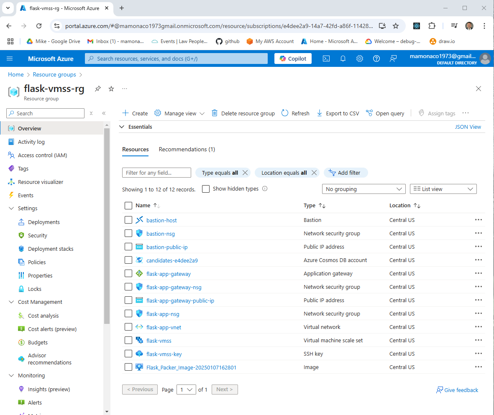

# Flask Microservice on an Azure VM Scale Set

Part 2 of the series
[Scaling in the Cloud: AWS Auto Scaling, Azure VMSS, and GCP MIGs](https://youtu.be/fogz73FXJEA).
A small Flask service that stores candidates in **Cosmos DB** is baked into
a managed image with **Packer**, then run behind an **Application Gateway**
in a **VM Scale Set** that adds and removes instances on CPU load.



| Piece | Where | Role |
|---|---|---|
| **Flask_Packer_Image** | managed image in `flask-vmss-rg` | Ubuntu 24.04 + the Flask app under gunicorn (systemd), `stress` for load tests |
| **flask-vmss** | `flask-app-subnet`, zones 1 and 2 | `Standard_B1s` instances from the newest image, 2 to 4; automatic upgrades; application health extension; system-assigned managed identity |
| **flask-app-gateway** | `app-gateway-subnet` | `Standard_v2`, HTTP 80, forwarding to the scale set on 8000; probe `/gtg` |
| **flask-vmss-autoscale** | `flask-vmss-rg` | scale-out and scale-in rules on `Percentage CPU` |
| **Cosmos DB** | Central US | serverless account `candidates-<id>`, `CandidateDatabase` / `Candidates`; the scale set's identity has a custom data role |
| **Azure Bastion** | `AzureBastionSubnet` | SSH to the instances from the portal |

## Architecture

<picture>
  <source media="(prefers-color-scheme: dark)" srcset="architecture-dark.svg">
  
</picture>

Regenerate with `python3 make_diagram.py`.

- **`01-infrastructure/`**: the resource group (`flask-vmss-rg`), the VNet
  (`flask-app-vnet`) with the app, gateway and Bastion subnets, the NSGs,
  the Application Gateway, Bastion, the SSH key resource, and Cosmos DB.
- **`02-packer/`**: `flask_image.pkr.hcl`, `install.sh` and the app in
  `scripts/`, plus `main.tf`, which builds the scale set, its autoscale
  setting and its Cosmos DB role.
- **`build/`**: the per-phase scripts `apply.sh` and `destroy.sh` call, in
  Bash and PowerShell.

## How it builds

1. **Phase 1**: Terraform builds the network, gateway, Bastion and Cosmos DB.
2. **Phase 2**: Packer builds `Flask_Packer_Image-<timestamp>`.
3. **Phase 3**: Terraform finds the newest image and creates the scale set
   with 0 instances, restarts it, then applies again with 2.

## How it scales

| Rule | Condition | Action |
|---|---|---|
| Scale out | average `Percentage CPU` **above 60%** over 1 minute | add 1 instance, 1-minute cooldown |
| Scale in | average `Percentage CPU` **below 60%** over 5 minutes | remove 1 instance, 1-minute cooldown |

The scale set stays between 2 and 4 instances.

## API

| Method | Path | Returns |
|---|---|---|
| GET | `/gtg` | 200; with `?details=true`, connection and instance details |
| GET | `/candidate/<name>` | the candidate, or 404 |
| POST | `/candidate/<name>` | `{"CandidateName": <name>}`, or 500 |
| GET | `/candidates` | every candidate, or 404 |

## Network security

```
internet ─80─▶ flask-app-gateway ─8000─▶ flask-vmss
internet ─443─▶ Azure Bastion ─22─▶ flask-vmss
```

`flask-app-nsg` allows 22 and 8000 from anywhere; `flask-app-gateway-nsg`
allows 80 and the gateway's management range (65200-65535).

## Prerequisites

* [An Azure Account](https://portal.azure.com/)
* [Install AZ CLI](https://learn.microsoft.com/en-us/cli/azure/install-azure-cli)
* [Install Terraform](https://developer.hashicorp.com/terraform/install)
* [Install Packer](https://developer.hashicorp.com/packer/install)

`check_env.sh` expects a service principal in `ARM_CLIENT_ID`,
`ARM_CLIENT_SECRET`, `ARM_SUBSCRIPTION_ID` and `ARM_TENANT_ID`; Packer uses
the same credentials. If this is your first time watching our content, we
recommend starting with this video:
[Azure + Terraform: Easy Setup](https://www.youtube.com/watch?v=wwi3kVgYNOk).

## Deploy

```bash
git clone https://github.com/mamonaco1973/azure-flask-vmss.git
cd azure-flask-vmss
./apply.sh       # or .\apply.ps1
```

Everything deploys to Central US. `apply.sh` ends by running
`validate.sh`, which waits for a healthy backend on the gateway and runs the
smoke test:

```
NOTE: At least one healthy backend server found!
NOTE: Health check endpoint is http://<gateway-ip>/gtg?details=true
✓ good to go passed
✓ insert passed
✓ verification passed
✓ candidate list passed
```

## Try it

1. Open the `/gtg?details=true` URL in Postman (or `curl`) a few times: the
   instance changes as the gateway spreads requests.

   

2. Load the scale set: connect to an instance through Bastion and run
   `stress --cpu 2 --timeout 600`. Within a couple of minutes the scale set
   adds an instance; about five minutes after the load stops, it removes
   one.

## Teardown

```bash
./destroy.sh     # or .\destroy.ps1: destroys the scale set, deletes the images, then destroys the infrastructure
```

## Notes

- **Lab only.** The gateway is plain HTTP, and `flask-app-nsg` opens 22 and
  8000 to the internet.
- `01-infrastructure/keys/` holds the scale set's SSH key pair, committed to
  this public repository, and port 22 is open: anyone with the private key
  can sign in as `azureuser`. Generate your own key pair for anything more.
